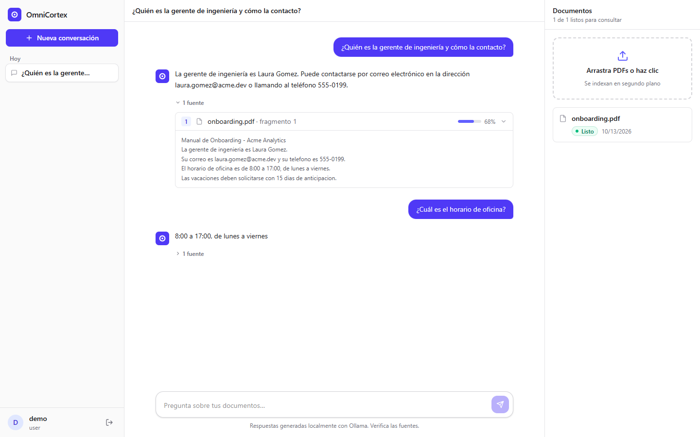
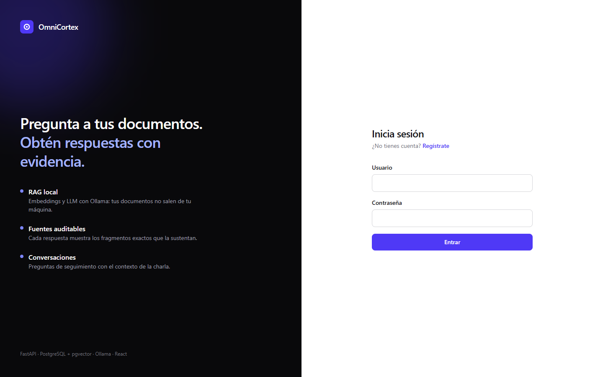
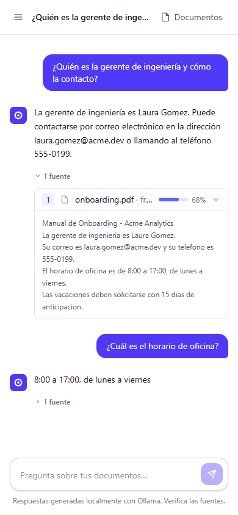

# OmniCortex

[](https://github.com/Jflelion/omnicortex/actions/workflows/ci.yml)

OmniCortex is a document intelligence platform (FastAPI backend + React frontend). Users upload PDFs, the API extracts and indexes their content, and questions are answered with a local RAG pipeline (pgvector + Ollama) that returns the sources used.



<p align="center">
  
  &nbsp;
  
</p>

## Stack

- FastAPI
- PostgreSQL 16 + pgvector (Docker)
- SQLAlchemy + Alembic
- Pydantic / pydantic-settings
- PyJWT + Passlib (bcrypt)
- PyMuPDF for text extraction
- Ollama: `nomic-embed-text` (embeddings) and `qwen2.5:3b` (generation)
- Frontend: React 19 + TypeScript + Vite + Tailwind CSS

## Features

- JWT authentication and role-based authorization (`admin`, `user`, `analyst`)
- Public registration (always assigned the `user` role)
- PDF upload with type and size validation
- Text extraction, chunking with overlap and background embedding generation
- Document processing status (`processing` → `ready` / `failed`) with error message and retry endpoint
- Cascade deletes: removing a document or user removes its chunks and stored files
- Semantic search and hybrid retrieval (vector + keyword) with reranking
- `/documents/ask`: grounded answers with auditable sources
- Conversations: persistent chat history, follow-up questions resolved with previous turns, automatic titles
- Request IDs and per-stage timing of the RAG pipeline
- `/health` endpoint and configurable CORS
- Dockerfile + docker-compose (API + Postgres)
- `503 Service Unavailable` when Ollama is down or times out

## Project Structure

```text
omnicortex/
├── app/
│   ├── ai/llm/           # LLM client (Ollama) and normalized response model
│   ├── core/             # config, security, JWT, permissions, exceptions
│   ├── database/         # session, seed, embed_chunks (re-index tool)
│   ├── models/           # SQLAlchemy models
│   ├── observability/    # logging, request ID, RAG tracing
│   ├── routers/          # auth, users, roles, documents
│   ├── schemas/          # Pydantic schemas
│   ├── services/         # extraction, chunking, embeddings, retrieval, RAG
│   └── main.py
├── frontend/             # React + TypeScript chat UI
├── alembic/              # migrations
├── docs/                 # architecture, decisions, changelog, roadmap
├── scripts/              # manual checks
├── tests/
├── docker-compose.yml
├── requirements.txt
├── requirements-dev.txt
├── .env.example
└── run.py
```

## Setup

### Option A: everything in Docker

Requires Docker and Ollama running on the host.

```powershell
copy .env.example .env      # set SECRET_KEY and POSTGRES_PASSWORD
ollama pull nomic-embed-text
ollama pull qwen2.5:3b
docker compose up -d --build
```

Open http://localhost:3000 and create an account.

- `web` (port 3000): nginx serving the React build and proxying `/api` to the API.
- `api` (port 8000): applies migrations and seeds the default roles on startup. It reaches Ollama on the host through `host.docker.internal`. Swagger at http://localhost:8000/docs.
- `db` (port 5432): PostgreSQL 16 + pgvector.

Note: `POSTGRES_*` values only take effect the first time the database volume is created.

### Option B: local development

```powershell
python -m venv venv
venv\Scripts\activate
pip install -r requirements-dev.txt
copy .env.example .env

docker compose up -d db
alembic upgrade head
python -m app.database.seed

ollama pull nomic-embed-text
ollama pull qwen2.5:3b

python run.py
```

`DATABASE_URL` in `.env` must use the same user, password and database as `POSTGRES_*`. Every other setting has a default (see `app/core/config.py`).

### Health check

`GET /health` returns 200 when the database and Ollama (with both models) are reachable, and 503 with details otherwise.

Swagger: http://127.0.0.1:8000/docs

## Usage Flow

1. Register with `POST /users/`.
2. Log in with `POST /auth/login` and use the token in Swagger `Authorize`.
3. Upload a PDF with `POST /documents/upload`. Embeddings are generated in the background after the response; poll `GET /documents/{id}` until `status` is `ready`. If it ends up `failed` (e.g. Ollama was down), retry with `POST /documents/{id}/reindex`.
4. Ask with `POST /documents/ask` or search with `POST /documents/search`.

If Ollama was down during an upload, the chunks stay without embeddings. Index them later with:

```powershell
python -m app.database.embed_chunks
```

## API

### Health

- `GET /health`

### Auth

- `POST /auth/login`
- `GET /auth/me`

### Users

- `POST /users/` — public registration
- `GET /users/{user_id}` — admin
- `PUT /users/{user_id}` — admin (the only way to change a user's role)
- `PATCH /users/{user_id}/deactivate` — admin
- `PATCH /users/{user_id}/activate` — admin
- `DELETE /users/{user_id}` — admin

### Roles

- `POST /roles/` — admin
- `GET /roles/`

### Documents (owner only)

- `POST /documents/upload`
- `GET /documents/`
- `GET /documents/{document_id}`
- `GET /documents/{document_id}/chunks`
- `DELETE /documents/{document_id}`
- `POST /documents/{document_id}/reindex`
- `POST /documents/search`
- `POST /documents/ask`

### Conversations (owner only)

- `POST /conversations/`
- `GET /conversations/` — most recent first
- `GET /conversations/{conversation_id}` — with messages and their sources
- `PATCH /conversations/{conversation_id}` — rename
- `DELETE /conversations/{conversation_id}`
- `POST /conversations/{conversation_id}/messages` — ask inside the conversation

## Frontend

Chat UI in [frontend/](frontend/): login and registration, PDF upload with live processing status (and retry for failed documents), conversation history, and answers with expandable sources showing the file, chunk and semantic similarity.

```powershell
cd frontend
npm install
npm run dev        # http://localhost:5173
```

In development, Vite proxies `/api` to the backend at `http://localhost:8000` (override with `VITE_PROXY_TARGET`), so no CORS setup is needed. `npm run build` type-checks and builds to `frontend/dist`.

## Development Notes

- Alembic controls the schema. Do not use `Base.metadata.create_all()`.
- Create migrations with `alembic revision --autogenerate -m "message"`.
- Run tests with `pytest`.
- CI (GitHub Actions) runs the backend tests, the full migration cycle on PostgreSQL + pgvector with `alembic check`, the frontend lint and build, and builds both Docker images.

## Roadmap

See [docs/ROADMAP.md](docs/ROADMAP.md).
